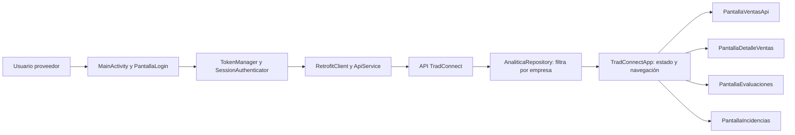

# TradConnect Analytic

Aplicación Android para consultar indicadores de ventas, evaluaciones de clientes e incidencias asociadas a una empresa proveedora de TradConnect. Es una extensión analítica de la plataforma de venta; la app móvil no sustituye la plataforma ni accede directamente a las bases de datos.

## Estado funcional

La versión actual está preparada para el rol **Proveedor**. La sesión debe corresponder a una empresa que la API pueda verificar. Los demás roles aún no tienen un flujo de datos y autorización implementado en esta app.

La navegación tiene cuatro secciones:

- **Ventas:** resumen del mes, comparación con el mes anterior, indicadores y evolución según el periodo elegido.
- **Detalle:** ventas por categoría e ingresos, métodos de pago, productos más vendidos, productos por debajo del promedio y clientes frecuentes.
- **Evaluaciones:** calificación promedio, promedios por aspecto, reseñas y comentarios posteriores a la compra.
- **Incidencias:** reportes abiertos, resueltos y resumen por tipo o estado.

El detalle usa el tipo de medida asociado al producto que devuelve la API. Las cantidades fraccionarias se presentan con hasta dos decimales. La participación por categoría se basa en ingresos para no sumar medidas incompatibles.

## Tecnologías

- Kotlin y Jetpack Compose con Material 3.
- Android Gradle Plugin 9.3.3, Gradle Wrapper 9.5.0 y toolchain JDK 25.
- Kotlin 2.2.10, Android SDK 37 y nivel mínimo de Android 24.
- Retrofit 2.11.0, Gson y OkHttp para consumir la API.
- Lucide Compose para iconos.
- Coil 3 para imágenes remotas.
- Android Keystore para proteger la sesión en el dispositivo.

Las versiones de dependencias están en `gradle/libs.versions.toml`, y la configuración Android está en `app/build.gradle.kts`.

## Organización

```text
app/src/main/java/com/example/tradconnect_analytic/
├── MainActivity.kt                  Inicio, sesión persistida y decisión de acceso
├── TradConnectApp.kt                Carga de datos, estado de sesión y navegación inferior/lateral
├── datos/
│   ├── ApiService.kt                Contrato de rutas Retrofit
│   ├── AnaliticaRepository.kt       Carga, filtrado por empresa y coordinación de respuestas
│   ├── AnaliticaApiModels.kt        Modelos de respuestas analíticas y MongoDB
│   ├── PedidoSqlApi.kt              Modelos de pedidos y catálogos SQL
│   ├── LoginModels.kt               Solicitudes y respuestas de autenticación
│   ├── RetrofitClient.kt            URL base, cliente HTTP e imágenes
│   ├── SessionAuthenticator.kt       Renovación de acceso ante respuestas 401
│   └── TokenManager.kt              Almacenamiento cifrado de sesión
├── pantallas/
│   ├── PantallaLogin.kt              Acceso de proveedor
│   ├── PantallaVentasApi.kt          Indicadores y resumen de ventas
│   ├── PantallaDetalleVentas.kt      Vista y componentes exclusivos del detalle
│   ├── PantallaEvaluaciones.kt       Evaluaciones y comentarios postcompra
│   └── PantallaIncidencias.kt        Incidencias por estado y tipo
└── ui/theme/                         Colores, tipografía y tema Compose
```

Los modelos compartidos de interfaz están en `datos/AnaliticaModels.kt`. Las pantallas reciben datos desde `TradConnectApp`; las llamadas HTTP se mantienen en `ApiService` y el filtrado/ensamblado en `AnaliticaRepository`.



## Flujo de datos

1. `MainActivity` inicializa Retrofit y consulta la sesión guardada.
2. `PantallaLogin` envía las credenciales a `POST /auth/login/`.
3. `TokenManager` cifra los tokens con Android Keystore. `SessionAuthenticator` intenta renovarlos con `POST /auth/refresh/` cuando una petición protegida recibe un 401.
4. `TradConnectApp` solicita los datos del proveedor mediante `AnaliticaRepository`.
5. El repositorio verifica la empresa de la sesión, carga los pedidos y productos SQL, catálogos de moneda y pago, analítica MongoDB y las colecciones de evaluaciones, comentarios e incidencias.
6. El repositorio filtra las respuestas por el identificador de empresa antes de entregarlas a las pantallas.
7. Los indicadores se calculan en el dispositivo usando los pedidos y detalles entregados por la API. Si falta un detalle requerido, la pantalla muestra que el indicador no está disponible en vez de completar datos ficticios.

### Rutas consumidas

- `POST /auth/login/`
- `POST /auth/refresh/`
- `GET /empresas/`
- `GET /nosql/proveedor/analitica/?start=...&end=...`
- `GET /pedidos/`
- `GET /productos/`
- `GET /monedas/`
- `GET /metodos-pago/`
- `GET /nosql/mi-empresa/evaluaciones_proveedores/`
- `GET /nosql/mi-empresa/comentarios_post_compra/`
- `GET /nosql/mi-empresa/incidencias_entregas/`

La app no conecta directamente a SQL Server ni a MongoDB; solo consume las rutas existentes de la API. No ampliar los datos en la app con consultas directas a las bases de datos.

### Criterios de cálculo

- El repositorio identifica la empresa del proveedor desde la sesión y filtra pedidos, productos, evaluaciones, comentarios e incidencias por ese identificador.
- Se excluyen los pedidos con estado Cancelado o Cancelada. Los pedidos válidos se comparan con la moneda configurada para la empresa.
- El resumen mensual compara el mismo número de días transcurridos del mes actual y del anterior.
- La semana empieza el lunes. Los periodos Mes, Año e Histórico comienzan el primer día del mes, el 1 de enero y el límite histórico configurado por la API, respectivamente.
- El ranking de productos y clientes requiere líneas de detalle en los pedidos. Si la API no proporciona detalles completos, se oculta el ranking y se explica por qué.
- El promedio de estrellas se calcula con las evaluaciones disponibles. Las barras por aspecto solo aparecen cuando la respuesta incluye puntuaciones para ese aspecto.
- La API no ofrece en esta integración una ruta para las necesidades no satisfechas ni una operación para resolver incidencias; esos indicadores o acciones no se inventan en la app.

## Configuración local

1. Abre la carpeta del proyecto en Android Studio y espera la sincronización de Gradle.
2. Inicia la API Django en la computadora y confirma que el teléfono o emulador pueda alcanzar esa computadora por la red.
3. Revisa `BASE_URL` en `datos/RetrofitClient.kt`. Para un teléfono físico usa la IP LAN de la computadora; teléfono y computadora deben estar en la misma red. Para un emulador estándar, normalmente se usa `10.0.2.2` para acceder al host.
4. Para desarrollo, Gradle configura `allowCleartextTraffic=true` en `debug`, y `app/src/debug/res/xml/network_security_config.xml` permite HTTP solo al host LAN de la API. La configuración de `main` y el tipo `release` bloquean HTTP. La versión publicada debe apuntar a una API HTTPS.
5. Ejecuta la configuración `app` desde Android Studio o conecta el teléfono con depuración USB.

La URL base configurada actualmente es la dirección LAN de desarrollo `http://10.39.239.249:8000/api/`. Actualízala si la IP de la computadora cambia. En ese caso actualiza también el dominio en `app/src/debug/res/xml/network_security_config.xml`. La API debe escuchar en esa interfaz y aceptar el host LAN en su configuración `ALLOWED_HOSTS`. CORS no limita las peticiones HTTP nativas de Android.

## Compilación

En Windows PowerShell, desde la raíz del proyecto:

```powershell
.\gradlew.bat :app:assembleDebug
```

Para compilar Kotlin sin generar el APK:

```powershell
.\gradlew.bat :app:compileDebugKotlin
```

El APK de depuración se genera en `app/build/outputs/apk/debug/`.

## Navegación y destinos externos

El acceso de Power BI abre el [portal de Power BI](https://app.powerbi.com/). El destino web de TradConnect está temporalmente enlazado al mismo portal porque el repositorio no contiene una URL pública verificada para la plataforma. Cuando se defina el dominio oficial, actualiza `URL_SITIO_TRADCONNECT` al final de `TradConnectApp.kt`.

## Seguridad y publicación

- Mantén el filtrado por `empresaId` en el repositorio. No muestres registros de otras empresas.
- No incluyas contraseñas, tokens, archivos `local.properties` ni credenciales en el repositorio.
- No publiques el servidor de desarrollo Django ni una URL HTTP en una versión release.
- Antes de producir una versión de distribución, cambia `BASE_URL` a la API HTTPS de producción y valida el acceso autorizado con el rol Proveedor.
- El `AndroidManifest.xml` de `app/src/main` es el único manifiesto fuente. Gradle resuelve el permiso HTTP según el tipo de compilación y sus recursos de seguridad.
- Los proyectos Android generan manifiestos intermedios al combinar recursos; no se deben editar manualmente los archivos generados bajo `app/build/`.

## Mantenimiento

- Añade rutas y modelos en `datos/` y coordina su carga en `AnaliticaRepository`.
- Mantén la navegación y el estado global en `TradConnectApp`.
- Coloca cada módulo de interfaz en su archivo dentro de `pantallas/`. El detalle de ventas ya está separado de su resumen.
- Mantén colores y tipografía compartidos en `ui/theme/`.
- Documenta cualquier endpoint nuevo, sus campos requeridos y las reglas que limitan los datos por empresa.
